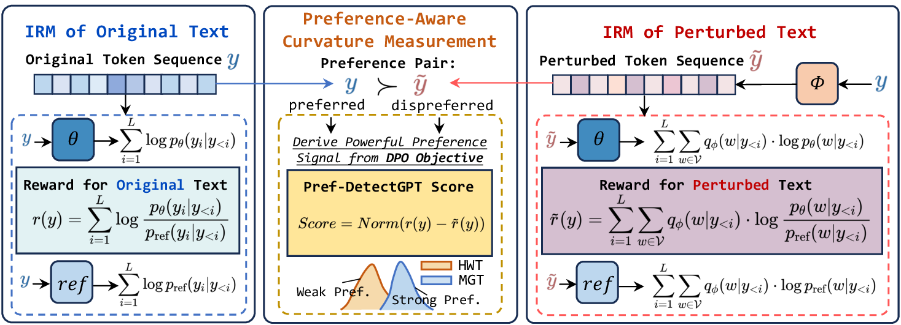

<h1 align="center">Pref-DetectGPT</h1>

<p align="center">
  <b>Unveiling Machine-Generated Text via Preference-Aware Curvature Measurement</b>
</p>

<p align="center">
  
</p>

Pref-DetectGPT is a **training-free** detector for machine-generated text. Instead of measuring
curvature in the log probability space like DetectGPT and Fast-DetectGPT, it measures curvature in
the **implicit reward space** of a preference-optimized surrogate model: the original text is the
preferred response, its perturbed variants are the dispreferred ones, and the normalized deviation
between their implicit rewards is the detection score.

---

## 🛠️ Environment

```bash
conda create -n Pref python=3.12 -y
conda activate Pref
pip3 install -r requirements.txt
```

---

## 📦 Preparation

### 1. Surrogate models

Log in to Hugging Face and request access to the gated Llama repos:

| Role | Default model | Needed for |
| :--- | :--- | :--- |
| Policy $p_\theta$ | `meta-llama/Llama-3.2-1B-Instruct` | all experiments |
| Reference $p_\text{ref}$ | `meta-llama/Llama-3.2-1B` | all experiments |
| Sampling $q_\phi$ | `meta-llama/Llama-3.2-1B` | all experiments |

The policy and reference models must share a tokenizer; the code asserts this at load time.

### 2. Baseline checkpoints

The supervised baselines (RoBERTa-Base / Large, ImBD, DetectAnyLLM, BiScope) need trained weights.
Uncomment the blocks you need in `scripts/train.sh` and run it; the checkpoints are written to
`ckpt/`, where the evaluation scripts expect them:

```bash
bash scripts/train.sh
```

All of them train on the same ImBD polish dataset (`datasets/ai_detection_500_polish.raw_data.json`).

---

## 🚀 Quick Start

Score one dataset with Pref-DetectGPT:

```bash
python Pref/eval_Pref_DetectGPT.py \
    --eval_data_path datasets/Main/HART.json \
    --eval_data_format ImBD \
    --eval_batch_size 8 \
    --policy_name_or_path meta-llama/Llama-3.2-1B-Instruct \
    --reference_name_or_path meta-llama/Llama-3.2-1B \
    --sample_name_or_path meta-llama/Llama-3.2-1B \
    --save_path results/Main/Pref-DetectGPT \
    --save_file Pref_HART.json
```

`--max_token_observed` defaults to 512, matching the paper. The output file carries both the metrics
and the raw per-text scores, so distributions can be replotted without rerunning the model:

```json
{
    "method": "Pref", "eval_dataset": "HART",
    "AUROC": 0.9595, "AUPR": 0.9647, "TPR_AT_FPR_5%": 0.8295, "F1": 0.8955,
    "human_scores": [...], "llm_scores": [...]
}
```

---

## 🧪 Experiments

One script per experiment. Each loops over its datasets, runs the detectors one by one, and writes
one JSON file per (method, dataset) pair — so you can comment out the method blocks you don't need.

| Script (under `scripts/`) | Experiment | Results |
| :--- | :--- | :--- |
| `Main/run_main.sh` | Main comparison, all 15 detectors | `results/main/` |
| `Attack/run_attack.sh` | Robustness to 4 adversarial attacks | `results/attack/` |
| `Len/run_len.sh` | Robustness across 16 input lengths | `results/Len/` |
| `Analysis/run_efficiency.sh` | Inference speed in s/1k tokens | `results/Analysis/Efficiency/` |
| `Analysis/run_model_pair.sh` | Qwen2.5-1.5B / Gemma-2-2B pairs | `results/Analysis/Model-Pair/` |
| `Analysis/run_sample_model.sh` | Sweep over the sampling model | `results/sample_model/` |
| `Analysis/run_generalization.sh` | Cross-dataset threshold transfer | `results/Analysis/Generalization/` |
| `Analysis/run_KL.sh` | KL divergence as a standalone score | `results/Analysis/Pref-KL/` |
| `Analysis/run_Prompt.sh` | Prompt-free vs. 4 domain prompts | `results/Analysis/Pref-Prompt/` |
| `Visual/run_multidomain.sh` | Per-domain score distributions | `results/Visual/` |

For example:

```bash
bash scripts/Main/run_main.sh
```

---

## 📁 Repository Structure

```
Pref/                   Pref-DetectGPT implementation and evaluation entry point
other_method/           baseline detectors + training scripts for the supervised ones
Analysis/               method variants used by the analysis experiments
  ├─ Pref_KL/           KL-divergence-only ablation
  ├─ Pref_prompt/       prompt-conditioned variant
  └─ Genelization/      threshold-transfer variants of every method
scripts/                one script per experiment
datasets/               evaluation data
ckpt/                   checkpoints of the supervised baselines
results/                evaluation outputs
```
